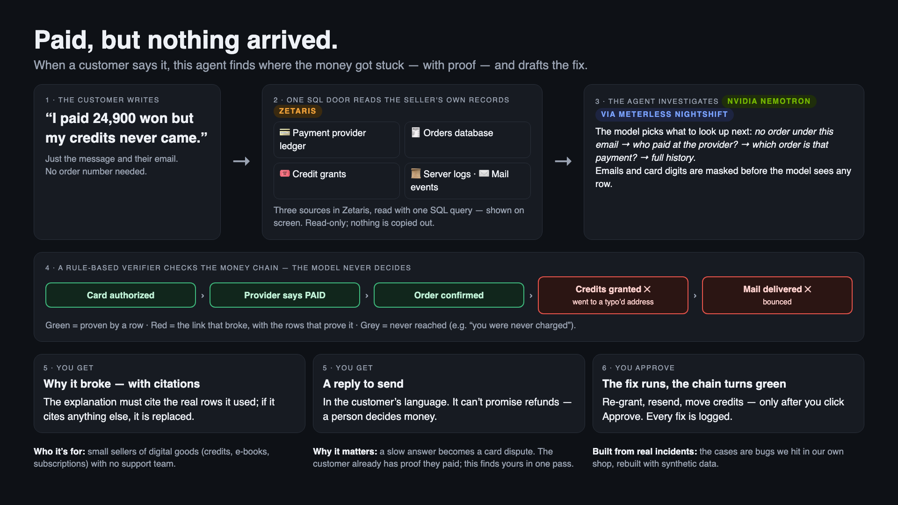

# Paid, but nothing arrived
## The agent that finds the broken link

Track 02 — The Agent That Can Explain Why · Team MoaHub (solo)

> Your customer already has proof they paid. This agent finds yours.

---

# How it works, in one picture

---

# The problem, the user

- Who: a one-person or small online seller of digital goods, credits, subscriptions. No support team.
- The message: **"I paid, but nothing arrived."**
- Slow answer → card dispute, *product not received*. The customer holds the proof (their bank's payment text). The seller has to find theirs.

---

# Today: four screens, by hand

Payment-provider dashboard · orders database · server logs · mail provider

Same question asked four times, lined up by eye. We did this ourselves while auditing our own checkout.

---

# The solution: one chain, one broken link

`card authorized → payment provider paid → order confirmed → credits granted → mail delivered`

Every link is green up to the one that broke. Click the link → the raw row that proves it. Then: reply draft · fix (needs approval) · dispute evidence bundle.

---

# Agent workflow

1. locate the order (email / order id)
2. `order_journey` — one read-only SQL statement to Zetaris, joining five tables across three datasources
3. deterministic verifier: each link green / red / grey, with refs
4. Nemotron (via Nightshift) explains and drafts the reply; the fix comes from the verifier
5. citation + claim check: the explanation may cite only returned `ref`s, and every amount, record id, email domain and payment, credit or mail status in each sentence must match the rows it cites (on unseen sentences from a separate model: 32/40 wrong caught) — or it is replaced by the verifier's text

---

# Technical stack

Python 3.12 · FastAPI · Zetaris (JDBC driver, unified semantic layer) · Meterless Nightshift · NVIDIA Nemotron 3.5 Lightning · DuckDB (tests) · built with Cursor (project rules in `.cursor/rules`)

---

# How Zetaris was used

- Three datasources: shop app DB (`demo_pg`), payment-provider ledger (`psp_pg`), mail-provider events (`mail_pg`), joined in the semantic layer `order_journey`; the agent reads an order's whole history with one query, and the page shows it.
- The agent sends SQL only. Nothing is copied. Every row carries `table:key`.
- Same SQL on DuckDB for tests; backend name printed on every result.

---

# Zetaris: the same query, in Zetaris

The agent's journey query in Zetaris's SQL Workspace: three datasources, one statement — order under `exmaple.com`, payer `example.com`, mail sent then bounced.

---

# How Meterless + NVIDIA were used

- Every model call goes through Nightshift on the Mac: a Nemotron lane (NVIDIA's hosted endpoint in the demo), a receipt for every answer. Addresses are masked and card digits removed before the model sees rows.
- Nemotron explains and drafts; it never decides the verdict.
- Measured on Zetaris (three datasources), six runs: right order and link 6/6 every run; final code: loop named the order 6/6, every returned explanation passed the sentence check (5/5); cross-customer probe blocked every run; claim check on unseen sentences: 32/40 wrong caught, 2/20 true wrongly rejected; 24 automated tests.

---

# Product

Case 6, live through Zetaris: paid with one address, the order was saved under a typo (exmaple.com). Two red links, each with the rows that prove it; the reply asks the customer to confirm, the fix waits for approval.

---

# Product — when nothing is broken

Case 5: grey chain, "You were never charged." The message also quoted another customer's order (ord_0903): not read, and the page says so. All data synthetic.

---

# What's next

- Real payment-provider connectors (Stripe, PortOne) and mail providers as Zetaris REST sources
- Screenshot reading (receipt / card SMS) with a local vision model
- Installable edition for sellers; full Korean text for chain notes and fixes
